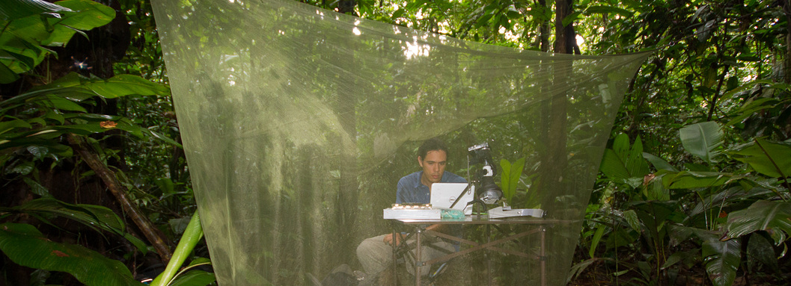

Marcelo Araya-Salas

Another behavioral ecologists that ended up doing a lot of coding just to get data analysis done. I'm deeply involved in the development of computational tools for (non-molecular) biological data analysis, mostly related to animal behavior and bioacoustics. I am the developer and maintainer of the R packages [warbleR](https://marce10.github.io/warbleR/index.html) and [Rraven](https://marce10.github.io/Rraven/index.html) that provide functions to streamline high-throughput acoustic analysis of animal sounds, aiming to simplify the use of R for bioacoustic research. More recently I released the R packages [baRulho](https://ropensci.github.io/baRulho/), to quantify acoustic signal transmission and degradation, [ohun](https://docs.ropensci.org/ohun/), to optimize automatic detection, [PhenotypeSpace](https://marce10.github.io/PhenotypeSpace/index.html) for quantifying multidimensional trait spaces and [suwo](https://cran.r-project.org/package=suwo) to access nature media repositories.

